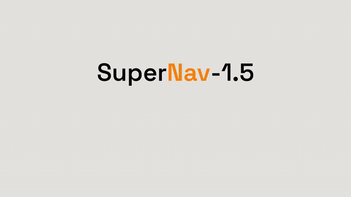
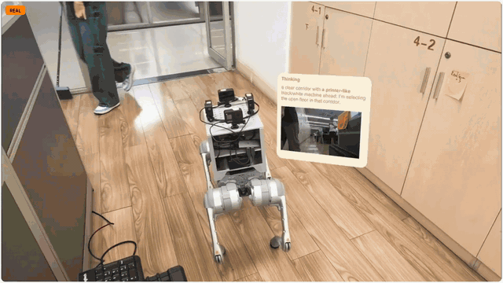

<div align="center">

<h1>SuperNav</h1>

<h3>An Agentic Navigation Systems For Any Task in Any Scene</h3>

<p><strong>English</strong> | <a href="README.zh-CN.md">简体中文</a></p>

</div>

This repository collects the SuperNav series. From navigation agent harness (v1) to structured spatial memory (v1.5).

| | [SuperNav-1.5](SuperNav_v1_5/README.md) | [SuperNav](SuperNav_v1/README.md) |
| --- | --- | --- |
| Focus | Structured spatial memory for agentic navigation | A General agentic navigation framework for navigation |
| Explore | [Code and usage](SuperNav_v1_5/README.md) · [Project](https://zju3dv.github.io/SuperNav-1.5/)| [Code and usage](SuperNav_v1/README.md) · [Project](https://zju3dv.github.io/SuperNav/)|

<div align="center">

<h2>🧭 SuperNav-1.5: Structured Spatial Memory For Agentic Navigation Systems</h2>

<hr>

<p>
  <a href="https://zju3dv.github.io/SuperNav-1.5/"></a>
  <a href="https://arxiv.org/abs/2611.29912"></a>
  <a href="SuperNav_v1_5/README.md"></a>
</p>

<p>
  Jiarui Guo<sup>1</sup> ·
  <a href="https://the0xka1.cc/">Jinkai Zhang</a><sup>1</sup> ·
  <a href="https://yuanhongyu.xyz/">Yuanhong Yu</a><sup>1</sup> ·
  Yongchen Zai<sup>2</sup> ·
  Futang Zhu<sup>2</sup> ·
  <a href="https://csse.szu.edu.cn/pages/user/index?id=531">Ruizhen Hu</a><sup>3</sup> ·<br>
  <a href="https://pengsida.net/">Sida Peng</a><sup>1</sup> ·
  <a href="https://xzhou.me/">Xiaowei Zhou</a><sup>1</sup>
</p>

<p>
  <sup>1</sup> Zhejiang University &nbsp;·&nbsp;
  <sup>2</sup> BYD New Technology Research Institute &nbsp;·&nbsp;
  <sup>3</sup> Shenzhen University
</p>

<a href="https://raw.githubusercontent.com/bugByteMe/SuperNav-1.5-assets/main/assets/overview/supernav-1.5-overview.mp4">
  
</a>

</div>

SuperNav-1.5 gives navigation agents structured spatial memory: an
area-segmented occupancy map with agent-maintained memory nodes. It connects
scene recall to executable routes, helping the agent explore efficiently, reach
successive goals, and reuse memory across sessions. When this method is selected,
it owns spatial state for the experiment and the original bounded spatial-fact
ledger is disabled.

[Code and usage](SuperNav_v1_5/README.md) ·
[Installation](SuperNav_v1_5/docs/release/en/spatial-memory.md#install-and-build) ·
[Project](https://zju3dv.github.io/SuperNav-1.5/) ·
[Spatial memory guide](SuperNav_v1_5/docs/release/en/spatial-memory.md) ·
[Citation](SuperNav_v1_5/README.md#citation)

<br>

<div align="center">

<h2>🌐 SuperNav: An Agentic Navigation System for Any Task in Any Scene</h2>

<hr>

<p>
  <a href="https://zju3dv.github.io/SuperNav/"></a>
  <a href="https://arxiv.org/abs/2610.12126v1"></a>
  <a href="SuperNav_v1/README.md"></a>
  <a href="SuperNav_v1/docs/release/assets/wechat.png">
      
    </a>
</p>

<p>
  <a href="https://the0xka1.cc/">Jinkai Zhang</a><sup>1</sup> ·
  <a href="https://echo636.github.io/">Jingyi Xu</a><sup>1</sup> ·
  <a href="https://yuanhongyu.xyz/">Yuanhong Yu</a><sup>1</sup> ·
  Jiarui Guo<sup>1</sup> ·
  <a href="https://csse.szu.edu.cn/pages/user/index?id=531">Ruizhen Hu</a><sup>2</sup> ·<br>
  <a href="https://person.zju.edu.cn/0093140">Hujun Bao</a><sup>1</sup> ·
  <a href="https://xzhou.me/">Xiaowei Zhou</a><sup>1</sup> ·
  <a href="https://pengsida.net/">Sida Peng</a><sup>1,3†</sup>
</p>

<p>
  <sup>1</sup> Zhejiang University &nbsp;·&nbsp;
  <sup>2</sup> Shenzhen University &nbsp;·&nbsp;
  <sup>3</sup> Causa Robotics<br>
  <sup>†</sup> Corresponding author
</p>

<a href="https://github.com/user-attachments/assets/d415a2ec-89de-4f6d-a2e5-eeec8993d05d">
  
</a>

</div>

SuperNav uses a pretrained multimodal model, navigation tools, task-progress
tracking, and context management to solve diverse navigation tasks without
navigation-specific fine-tuning of the model. It supports tasks ranging from
finding a single object and visiting multiple targets to fulfilling high-level
requests across simulation and real-robot settings.

[Code and usage](SuperNav_v1/README.md) ·
[Installation](SuperNav_v1/README.md#installation) ·
[Project](https://zju3dv.github.io/SuperNav/) ·
[Citation](SuperNav_v1/README.md#citation)

## Getting Started

Clone all versioned dependencies, then enter the work you want to use:

```bash
git clone --recurse-submodules https://github.com/zju3dv/SuperNav.git
cd SuperNav/SuperNav_v1_5  # or SuperNav_v1
```

Create a separate environment for each work. Both directories publish the
Python package and command name `supernav`, so they should not be installed into
the same environment. SuperNav-1.5 uses `environment-cartographer.yml` for the
native Cartographer toolchain and the documented pip installation for the
Python runtime; original SuperNav uses the pip installation in its README.

## 🙏 Acknowledgements and License

SuperNav uses [Habitat-GS](https://github.com/zju3dv/habitat-gs),
[Habitat-Sim](https://github.com/facebookresearch/habitat-sim), and
[AI2-THOR](https://github.com/allenai/ai2thor) as simulator foundations. We thank
their authors and the contributors to the datasets and tools used in this project.

SuperNav is distributed under the [Project Registration License (PRL) v1.0](LICENSE).
Use solely for academic research, education, evaluation, or personal purposes is
free and does not require registration, including publication of research results.

Organizational project use is free but requires registration before use, including
commercial and non-commercial projects, internal R&D, testing, deployment, and
production. Complete and accurate registration automatically grants permission;
no approval or fee is required. Register each materially distinct project once.

**Project use registration:** [Google Forms](https://docs.google.com/forms/d/e/1FAIpQLSff5QjjANlJ2hnXYqBSAzKWxEM58gIxPLh17-t3j3-MqO1a5w/viewform).
